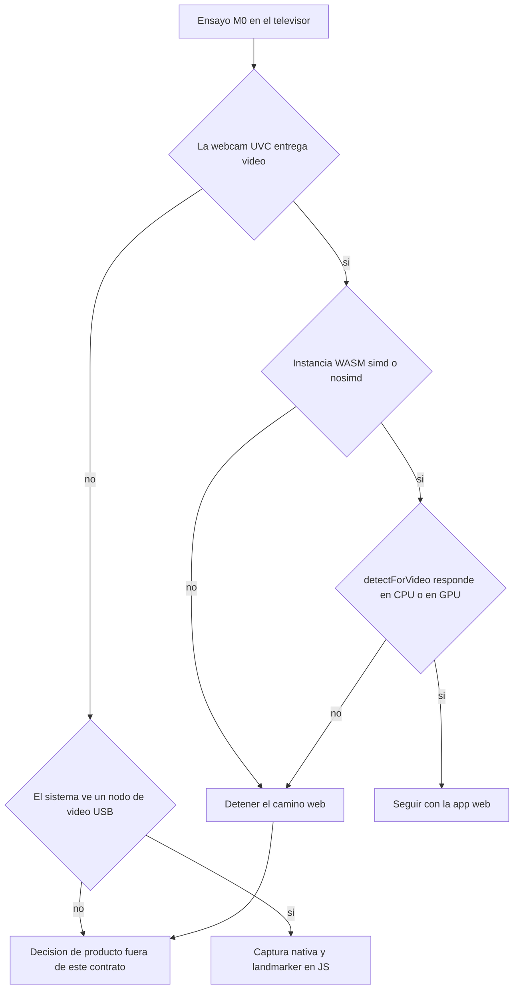

# Especificación de requisitos de software

**Producto:** Dibujo al aire, puerto Tizen (stb-hand-draw-tyzen)
**Versión del documento:** 1.0
**Fecha:** 2026-11-14
**Estado:** contrato previo a la implementación. En este repositorio todavía no hay aplicación.
**Estilo:** IEEE Std 830-1998, resumido, con el mismo tono que la SRS de la app Android.
**Idioma de la interfaz y de este documento:** español.

Este documento es el contrato de un paquete web Samsung Tizen (`.wgt`) que lleva a un televisor el comportamiento de [stb-hand-draw](https://github.com/CravApp/stb-hand-draw). También es la plantilla para el siguiente equipo: los requisitos `CORE` se copian, los `PLAT` se reescriben con el runtime de esa plataforma y los `DISP` se sustituyen por la ficha medida en ese equipo.

La app Android de referencia es el commit [`43044cbd59e62f3e268f081cb309c6e16034baf7`](https://github.com/CravApp/stb-hand-draw/commit/43044cbd59e62f3e268f081cb309c6e16034baf7) de `main` (2026-11-12), leído junto con su [`docs/SRS.md`](https://github.com/CravApp/stb-hand-draw/blob/main/docs/SRS.md) y su README.

## Historial

| Versión | Fecha | Descripción |
| --- | --- | --- |
| 1.0 | 2026-11-14 | Contrato del puerto Tizen: núcleo portable, capa web, ensayo de cámara y WASM, empaquetado e hitos. Sin código de la app. |

Cuando el ensayo M0 cierre, los resultados medidos se anotan en la ficha del apéndice E y, si cambian una decisión de este texto, se publica una 1.1. No se reescriben los `CORE` para disimular una medición.

## Cómo leerlo

1. La sección 3 fija qué lógica es común con Android y qué es Tizen.
2. Las secciones 4 y 5 son el comportamiento que hay que conservar.
3. La sección 10 es la puerta de entrada: en el televisor se mide cámara, WASM y WebGL antes de construir el pipeline.
4. La sección 12 enlaza cada requisito con el código Android que ya lo cumple.

## 1. Introducción

### 1.1 Propósito

Este documento describe el comportamiento observable de «Dibujo al aire» en el televisor Samsung indicado abajo, y la forma de construirlo sin volver a inventar el dibujo, el suavizado, los ajustes ni la línea de rendimiento.

Lo usan quien implementa el `.wgt`, quien lo prueba con el mando y la webcam, y quien porte el mismo núcleo a otro equipo.

### 1.2 Alcance

Incluye:

- El contrato de comportamiento, compartido con la app Android.
- La división entre un núcleo portable y una capa Tizen.
- Los requisitos de cámara, seguimiento de la mano, dibujo, mando, ajustes y medición.
- El empaquetado web (`.wgt`), los privilegios de `config.xml`, la firma y la instalación ya comprobadas en este televisor.
- Los riesgos del runtime web de Tizen 9, el ensayo que los cierra y las alternativas si la cámara o WASM no sirven.
- El plan de pruebas y los criterios de aceptación por hito.
- La tabla de trazabilidad hacia stb-hand-draw.

No incluye, en esta versión del documento ni en el producto que describe:

- El código de la aplicación. Este cambio es solo documentación.
- Tienda Samsung, Seller Office, cuentas, nube, grabación, galería o exportar el dibujo.
- Reconocimiento de gestos distinto de «mantener OK y seguir la yema del índice».
- Más de dos manos, modo vertical, lápiz táctil o ratón como herramienta de dibujo.
- Modificar el repositorio Android. El núcleo se reimplementa aquí contra las pruebas ya existentes; extraer un paquete Kotlin compartido queda fuera.
- Dar por bueno un camino con red (teléfono u otro decodificador compañero) como sustituto silencioso del modo sin red.

### 1.3 Definiciones

| Término | Significado |
| --- | --- |
| CORE | Requisito de producto, igual en el decodificador Android y en el televisor. |
| PLAT | Mecanismo de la plataforma. Aquí, aplicación web Tizen. En otro equipo se sustituye. |
| DISP | Dato o umbral de un equipo concreto. Se mide y se anota en la ficha. No se copia a ciegas. |
| Análisis | Imagen que entra al Hand Landmarker. Cabe en 640×480 o en 320×240 sin deformar ni ampliar. |
| Diestro / Zurdo | Mano de la persona que puede dibujar. |
| FPS | Resultados de inferencia por segundo, no fotogramas de la vista previa. |
| Hand Landmarker | Grafo de 21 puntos por mano. El punto 8 es la yema del índice. |
| Letterbox | Bandas para encajar la imagen en la pantalla sin recortar. |
| Lite / full | Dos archivos `.task`. El full es el oficial de Google. El lite es el paquete ya construido en stb-hand-draw. |
| Núcleo | Módulo sin DOM, sin `tizen.*` y sin MediaPipe. Lo cubren pruebas de unidad en el PC. |
| `.wgt` | Paquete de aplicación web Tizen, firmado e instalado con el CLI. |
| `.tpk` | Paquete nativo Tizen. Solo aparece como alternativa, si el ensayo lo pide. |
| Ensayo M0 | Página mínima, en el televisor, que responde las preguntas de la sección 10 antes de escribir el pipeline. |

### 1.4 Referencias

1. IEEE Std 830-1998, Recommended Practice for Software Requirements Specifications.
2. stb-hand-draw, commit `43044cbd59e62f3e268f081cb309c6e16034baf7`, en particular `docs/SRS.md`, `README.md` y las pruebas `DrawMathTest`, `HandMathTest`, `RemoteDecoderTest`.
3. MediaPipe Hand Landmarker para web: paquete npm `@mediapipe/tasks-vision` y la guía [Hand landmarks detection guide for Web](https://developers.google.com/edge/mediapipe/solutions/vision/hand_landmarker/web_js). La línea de versiones npm `0.10.x` no es el artefacto Maven `tasks-vision:1.2.3` de Android.
4. Referencia W3C del perfil TV de Tizen: `getUserMedia` figura como parcial y, en esa tabla, el televisor expone el micrófono. Privilegio `http://tizen.org/privilege/mediacapture`. [W3C/HTML5 API for TV](https://docs.tizen.org/application/web/api/latest/w3c_api/w3c_api_tv.html).
5. Privilegio público `mediacapture` para `getUserMedia`, y la clave de capacidad `http://tizen.org/feature/camera`. [Security and API Privileges](https://docs.tizen.org/application/web/tutorials/sec-privileges/), [Configuring Web Applications](https://developer.samsung.com/smarttv/develop/guides/fundamentals/configuring-tv-applications.html).
6. Mando Samsung: las teclas obligatorias no se registran; el resto pasa por `tizen.tvinputdevice.registerKey`. [Remote Control](https://developer.samsung.com/smarttv/develop/guides/user-interaction/remote-control.html), [TVInputDevice API](https://developer.samsung.com/smarttv/develop/api-references/tizen-web-device-api-references/tvinputdevice-api.html).

### 1.5 Visión general

La sección 2 describe el producto y el televisor. La sección 3 separa el núcleo de la plataforma. Las secciones 4 a 7 son los requisitos. Las secciones 8 y 9 son la vía técnica y el empaquetado. La sección 10 es el ensayo y las salidas si el runtime no alcanza. La sección 11 ordena el trabajo. La sección 12 lo ata a Android.

## 2. Descripción general

### 2.1 Perspectiva

La persona se coloca delante de una webcam USB UVC enchufada al televisor y dibuja en el aire. La yema del índice deja un trazo mientras mantiene OK en el mando. La imagen y el modelo se procesan en el televisor. La aplicación instalada no abre la red.

En Android eso ya ocurre con CameraX y MediaPipe Tasks nativo. Aquí la misma conducta sale de un núcleo reimplementado y de una capa que usa el runtime web de Tizen: `getUserMedia`, MediaPipe Tasks en JavaScript (WASM + delegado WebGL) y un lienzo encima de la vista previa.

El repositorio de Tizen hoy solo tiene este documento y el README. El nombre del repositorio conserva «tyzen»; el producto y el paquete son Tizen.

### 2.2 Funciones del producto

- Mostrar la webcam a pantalla completa, en horizontal, en espejo por defecto, con letterbox.
- Estimar una o dos manos y dibujar solo con la elegida.
- Medir FPS y milisegundos, en grande en pantalla y en una línea `HandDrawPerf` idéntica a la de Android.
- Cambiar mano, color, grosor, modelo, delegado, resolución, número de manos y espejo con el mando, y recordarlos.
- Explicar si falta el permiso, la webcam o el modelo, sin cerrarse por una excepción.

### 2.3 Usuarios

Una persona delante de la webcam, con el mando del televisor. Quien mide el rendimiento lee la línea `HandDrawPerf` en el inspector web del SDK y los números grandes de la pantalla. No hace falta pantalla táctil.

### 2.4 Ficha del equipo de referencia

Hechos comprobados en el equipo de laboratorio. Lo que no está en esta tabla está pendiente del ensayo M0 y no se inventa.

| Dato | Valor | Origen |
| --- | --- | --- |
| Producto | Samsung 75″ Business TV, serie BEFX-H | Comprobado |
| Modelo | LH75BEFHLGGXPE (2025) | Comprobado |
| Plataforma | Tizen 9.0, perfil TV | Comprobado |
| ABI | ARMv7, 32 bits (`core_abi` `arm_32`) | Comprobado |
| Panel | 3840×2160 | Comprobado |
| Red del equipo | Wi-Fi disponible. La app no la usa | Comprobado que hay Wi-Fi |
| Modo desarrollador | Activo | Comprobado |
| PC de instalación | Windows, Tizen Studio SDK 10, CLI `sdb` y `tizen` | Comprobado |
| Perfil de certificado | `203`, activo: certificado de autor y certificado distribuidor Samsung Public con el DUID de este televisor | Comprobado |
| Destino `sdb` | `10.50.123.97:26101` | Comprobado |
| Flujo de instalación | `tizen build-web`, `tizen package -t wgt -s 203`, `tizen install -n app.wgt -s 10.50.123.97:26101` | Comprobado |
| RAM | Pendiente de M0 | No medida para este documento |
| Viewport CSS (`innerWidth`, `innerHeight`, `devicePixelRatio`) | Pendiente de M0 | El panel 4K no dice el tamaño del layout web |
| GPU, WebGL1, WebGL2, SIMD, hilos WASM | Pendiente de M0 | |
| `getUserMedia` con la webcam UVC | Pendiente de M0 | La documentación de TV no lo promete |

El DUID, las contraseñas del certificado y los archivos `.p12` no se escriben en el repositorio ni en este documento.

### 2.5 Restricciones

| Aspecto | Restricción |
| --- | --- |
| Runtime de producto | Aplicación web Tizen empaquetada. El proceso del navegador es de 32 bits, como el `core_abi`. |
| Entrada de vídeo prevista | Webcam USB UVC. El ensayo demuestra si el runtime web la ve. |
| Entrada de usuario | Mando: flechas, OK y Atrás son obligatorios. Números, colores y teclas de medio son atajos si el televisor las entrega. |
| Modelos | Los dos `.task` van dentro del `.wgt`. Misma suma SHA-256 que en Android. |
| Red en el televisor | La app en ejecución no la necesita. El PC de desarrollo sí puede usar la red para `npm` y para copiar los `.wasm` al proyecto. |
| Memoria gráfica | El lienzo de dibujo no se reserva a 3840×2160. |
| Firma | Perfil `203` de este laboratorio. Otro televisor necesita su DUID en el certificado distribuidor. |

### 2.6 Suposiciones

- El comportamiento de referencia es el de stb-hand-draw en el commit citado, no una idea aproximada del dibujo.
- El archivo lite (`models/hand_landmarker_lite.task` de ese repo, 4 056 341 bytes, SHA-256 `d40f91342b5bcd27300529ba26476b248bf6ff3570fb28ff9e10bd8256b5dc43`) sigue siendo el lite. Está alineado a 4 bytes porque el runtime nativo 1.2.3 lo mapea así. Se copia tal cual. El ensayo dice si el runtime JavaScript lo acepta.
- El full es `hand_landmarker.task` float16 revisión 1, SHA-256 `fbc2a30080c3c557093b5ddfc334698132eb341044ccee322ccf8bcf3607cde1`.
- En el decodificador ZTE B866V2H (Android TV 14, S905X4, Mali-G31, 2 GB, solo 32 bits) el preset lite + GPU + 320×240 midió 14–15 FPS. Una línea típica del README es `fps=15 inferMs=60`. Ese número es la referencia del otro equipo, no un resultado de este televisor.
- El bitmap de análisis no está espejado. MediaPipe nombra la mano como en un selfie, así que la etiqueta se invierte. La vista previa sí se espeja, y los trazos usan el mismo volteo.
- Hay como máximo una inferencia en vuelo y un fotograma pendiente, que el siguiente sustituye. Si la inferencia no vuelve en 2 s, se admite otro fotograma. Es el contrato de RNF-01 de la SRS Android.
- La sustitución automática (lite que cae a full, GPU que cae a CPU) no se guarda como preferencia del usuario.
- El viewport web de un televisor 4K de Samsung a menudo es de 1920×1080 píxeles CSS. Hasta que M0 lo mida, el código no puede asumir ni 1920 ni 3840.

### 2.7 Usar este documento como plantilla

Para otro equipo (otro televisor, un STB web, un monitor con navegador cerrado):

1. Copiar el apéndice E y rellenar solo hechos medidos. Lo desconocido queda «pendiente».
2. Conservar las secciones 4 y 5 (`CORE`) y las pruebas de unidad que las fijan.
3. Volver a ejecutar el protocolo de la sección 10 en ese equipo antes de dar por buenos cámara, WASM, WebGL o los privilegios.
4. Reescribir la sección 9 con el empaquetado de esa plataforma. No arrastrar el perfil `203` ni la IP de este laboratorio.
5. Dejar la línea `HandDrawPerf` y el esquema de ajustes iguales, para comparar FPS entre equipos.
6. Si el ensayo cambia de camino (captura nativa, servicio nativo o compañero), subir la versión de la SRS. El camino nuevo no hereda el criterio de aceptación del camino web.

## 3. Arquitectura

### 3.1 Dos capas

```text
mando, webcam, pantalla, .wgt
        |
        v
+---------------------------+
| Capa Tizen                |  getUserMedia, lienzo, teclas DOM,
|                           |  tasks-vision, localStorage, config.xml
+---------------------------+
        |  fotograma, resultados, tecla abstracta
        v
+---------------------------+
| Núcleo portable           |  trazos, suavizado, letterbox,
|                           |  mano elegida, ajustes, línea de FPS,
|                           |  decodificador del mando
+---------------------------+
```

El núcleo no importa `document`, `navigator`, `tizen` ni `@mediapipe/tasks-vision`. La capa Tizen no reimplementa el suavizado, la selección de mano ni el formato del log: llama al núcleo.

La primera entrega del núcleo es TypeScript, con las mismas pruebas que los tres archivos Kotlin de unidad. No se exige Kotlin Multiplatform para cumplir este contrato: el runtime de destino es un navegador, y un toolchain nuevo no ayuda al ensayo M0. Un paquete compartido con Android puede llegar después, si las pruebas siguen en verde.

### 3.2 Qué se porta de cada archivo Android

| Archivo Android | Destino | Nota |
| --- | --- | --- |
| `draw/DrawingSession.kt`, `PointSmoother` | Núcleo | Constantes incluidas. |
| `draw/FrameMapping.kt`, `fittedSize` | Núcleo | Oráculos de `DrawMathTest`. |
| `draw/HandSkeleton.kt` | Núcleo | Lista `HAND_BONES`. |
| `hand/HandTypes.kt` | Núcleo | Etiqueta de mano, `selectHand`, `creationAttempts`, líneas de log. |
| `input/RemoteDecoder.kt` | Núcleo | La identidad de tecla pasa a un enumerado. Los enteros de `KeyEvent` se quedan en Android. |
| `hand/HandEngine.kt` | Partido | La política (un vuelo, un pendiente, marcas de tiempo crecientes, umbrales, reintentos, muestra por segundo) es del núcleo. Crear el grafo y llamar a `detect` es de la capa. |
| `camera/CameraController.kt`, `FrameWriter.kt`, `FrameBitmaps.kt` | No se portan | Los reemplaza `getUserMedia` y un lienzo pequeño. |
| `draw/DrawOverlayView.kt` | Capa | El lienzo usa `FrameMapping` del núcleo. |
| `MainActivity.kt` | Capa | Persistencia, HUD, paneles. El esquema de claves sí es contrato. |
| `AndroidManifest.xml`, ABI, CameraX, el `.so` de 32 bits | No entran al `.wgt` | El problema de `armeabi-v7a` de Android no se resuelve metiendo esa biblioteca en el paquete web. WASM es `wasm32`, que el navegador de 32 bits puede ejecutar si el ensayo lo confirma. |

### 3.3 Árbol previsto

Este árbol es el objetivo de la implementación. Este documento no lo crea.

```text
core/                 sin DOM ni MediaPipe
  drawing.ts          DrawingSession, PointSmoother
  mapping.ts          FrameMapping, fittedSize
  skeleton.ts
  hands.ts            etiqueta, selectHand, intentos de creación
  remote.ts           RemoteDecoder sobre KeyId
  perf.ts             líneas HandDrawPerf
  settings.ts         esquema y valores por defecto
platform/
  keys.ts             KeyboardEvent de Tizen -> KeyId
  camera.ts           getUserMedia y copia al tamaño de análisis
  landmarker.ts       @mediapipe/tasks-vision
  overlay.ts          lienzo
  hud.ts
  storage.ts          localStorage
web/
  index.html
  config.xml
  css/
models/               .task vendidos, comprobados por SHA-256
wasm/                 copiados de node_modules en la construcción, no de un CDN
```

Las pruebas del núcleo corren en Node, en el PC, sin televisor.

## 4. Requisitos funcionales

Ámbito de toda esta sección: **CORE**, salvo donde la fila dice otra cosa.

### 4.1 Arranque, idioma y paneles

| ID | Requisito |
| --- | --- |
| RF-01 | La aplicación se llama «Dibujo al aire», ocupa la pantalla en horizontal y está en español. |
| RF-02 | Sin permiso de cámara, se explica que la imagen se procesa en el equipo y no se envía a ningún sitio, y se puede pedir permiso. Si se niega, la app no se cierra por una excepción y ofrece reintentar. |
| RF-03 | Si no hay cámara, o no se puede abrir, hay un aviso y se puede reintentar. El texto distingue «no hay cámara» de «no se pudo abrir». |
| RF-17 | Con el aviso de permiso o la pregunta de borrado en pantalla, las flechas mueven el foco y no dibujan ni cambian la mano. En la pregunta, OK sobre «Borrar» borra y Atrás cancela. |

### 4.2 Seguimiento

| ID | Requisito |
| --- | --- |
| RF-04 | El detector es Hand Landmarker en modo de vídeo en vivo. Manos: 1 o 2, por defecto 1. Modelo: lite o full, por defecto lite. Delegado: CPU o GPU, por defecto GPU. Análisis: 320×240 o 640×480, por defecto 320×240. Umbrales de detección, presencia y seguimiento: 0,5. |
| RF-05 | El orden de creación es el de `creationAttempts`: lo pedido; si era lite, el full con el mismo delegado; si era GPU, el mismo modelo en CPU; si era lite y GPU, al final full en CPU. Un fallo de GPU durante la inferencia pasa a CPU. Lo cargado puede diferir de lo pedido. Esa sustitución no se escribe en los ajustes. En pantalla, un aviso breve dice que la GPU no estaba disponible o que el modelo pedido no arrancó. |
| RF-06 | Solo la mano elegida dibuja. La etiqueta sale de la handedness de MediaPipe invertida, porque el fotograma de análisis no está espejado (`Right` sin espejo es Zurdo, `Left` sin espejo es Diestro; el índice 0 y el 1 siguen ese mismo mapa). Si las dos manos detectadas son la elegida, gana la de mayor puntuación. Con `manos = 1`, MediaPipe puede seguir la mano que no está elegida: subir a 2 es el remedio, igual que en Android. |
| RF-18 | El espejo de la vista previa empieza activado. Los píxeles que entran al modelo no se espejan. El ajuste de espejo mueve la vista y los trazos juntos. |

### 4.3 Dibujo

| ID | Requisito |
| --- | --- |
| RF-07 | Con OK, Centro o Enter pulsado, la yema (punto 8) añade puntos suavizados al trazo. Soltar cierra el trazo. Una repetición de la tecla no abre un segundo trazo. El primer punto del suavizado se copia tal cual; por debajo de una distancia de 0,20 en coordenadas normalizadas el factor es 0,55; por encima, 0,85. No se añade un punto a menos de 0,004 del anterior. Un trazo se corta en 4000 puntos. Hacen falta al menos dos puntos para conservar el trazo al cerrarlo. |
| RF-08 | El punto del índice de la mano elegida se ve aunque no se esté dibujando. La otra mano, si aparece, se marca en gris y no dibuja. El esqueleto de la mano elegida se dibuja tenue con las conexiones de `HAND_BONES`. |
| RF-09 | Los trazos se guardan en coordenadas normalizadas del fotograma de análisis, sin espejo. Se proyectan con letterbox (`min` de las dos escalas, centrado) y el mismo espejo que la vista previa. La vista previa y el lienzo muestran el mismo encuadre: los dos salen del mismo fotograma de la webcam. Así se evita el desfase que Android documenta cuando la previa y el análisis son dos recortes distintos de CameraX. |
| RF-10 | ↑ deshace el trazo en curso o, si no hay, el último cerrado. ↓ borra todos los trazos sin preguntar. Atrás corto, si hay tinta, pregunta; si no hay tinta, sale. Atrás largo sale. Perder la mano cierra el trazo en curso; si OK sigue pulsado, la próxima detección abre otro trazo. |
| RF-14 | Como máximo hay una inferencia en vuelo. El fotograma que llega durante esa inferencia ocupa un único hueco pendiente y el siguiente lo sustituye. Las marcas de tiempo que ve MediaPipe son estrictamente crecientes. Si no hay resultado en 2 s, se libera el vuelo, se anota un atasco y se admite otro fotograma. |
| RF-15 | La vista previa sigue en movimiento aunque el modelo tarde. No se acumula una cola de fotogramas. |

### 4.4 Ajustes, mando y medición

| ID | Requisito |
| --- | --- |
| RF-11 | Se puede cambiar mano, color, grosor, modelo, número de manos, delegado, resolución de análisis y espejo. Esas ocho preferencias se recuerdan entre ejecuciones. El orden del panel es el de Android: mano, color, grosor, modelo, manos, delegado, resolución, espejo. |
| RF-12 | Los FPS y los milisegundos de la última inferencia se ven grandes. Cada segundo se emite una línea `HandDrawPerf` con las claves y el orden del apéndice C. `model` es el que quedó cargado; `requested` es el que pedía el ajuste. Un fallo al cargar se escribe en el mismo prefijo con `load` y `error`. |
| RF-13 | El paquete contiene el lite y el full, con las sumas SHA-256 de la sección 2.6, y los `.wasm` del runtime JavaScript fijado en la construcción. No los descarga al arrancar. |
| RF-16 | El mapa de acciones del mando es el del README de Android y el de `RemoteDecoder`. En cámara: ← corto cambia Diestro/Zurdo, ← largo abre ajustes; → corto cambia el color, → largo cambia el grosor; ↑ deshace; ↓ borra; OK mantenido dibuja. En ajustes: ↑↓ elige fila, ←→ y OK cambian el valor, Atrás cierra. Los atajos de número y color, si el mando los entrega, son los del apéndice B. La pulsación larga se reconoce con 6 repeticiones o, si el televisor no repite la tecla, a los 600 ms. Solo dispara una vez por pulsación. |

Colores, en este orden, por defecto el cian (índice 2): blanco `#FFFFFF`, amarillo `#FFE14A`, cian `#3DDCFF`, verde `#7DFF6A`, rojo `#FF5A6A`, rosa `#FF7AD9`.

Grosores, en este orden, por defecto «medio» (índice 1): fino, medio, grueso, muy grueso, con pesos relativos 4, 8, 14 y 22. En el lienzo, el peso en píxeles es ese número por `altoDelLienzo / 1080`, de modo que «medio» mide unos 8 píxeles en un viewport de 1080 líneas de alto. En Android el mismo índice se multiplica por la densidad de pantalla; el contrato portable es el índice, no el píxel físico.

### 4.5 Textos

Los textos de `app/src/main/res/values/strings.xml` de Android se reutilizan. El apéndice D lista los que ve la persona. No se reescriben para sonar distinto en el televisor.

## 5. Contrato del núcleo

Estos comportamientos ya tienen prueba en Android. La implementación los reproduce con los mismos números. Una prueba que falle bloquea el hito M1.

| Prueba Android | Oráculo que hay que conservar |
| --- | --- |
| `unmirroredFrameFlipsMediaPipeHandedness` | `Right` sin espejo → Zurdo; `Left` sin espejo → Diestro; `Right` con espejo → Diestro. |
| `indexFallbackMatchesTheBinaryLabelMap` | Índice 0 sin espejo → Zurdo; índice 1 → Diestro; índice 3 → ninguna mano. |
| `onlyThePreferredHandIsSelected` | `selectHand` ignora la otra mano aunque tenga más puntuación. |
| `higherScoreWinsWhenTheSameHandAppearsTwice` | Entre dos de la mano elegida, gana la puntuación mayor. |
| `creationFallsBackFromGpuAndLite` | lite/GPU, luego full/GPU, luego lite/CPU, luego full/CPU. full/CPU pedido no añade intentos. |
| `perfLineIsStableForAdb` | La cadena exacta del apéndice C, prefijo aparte. |
| `letterboxCentersAFourByThreeFrame` | Vista 1920×1080, imagen 640×480, sin espejo: escala 2,25, origen en (240, 0), extremo en (1680, 1080). |
| `mirrorFlipsXInsideTheSameLetterbox` | Con espejo, x normalizada 0 cae en 1680. El punto (0,25, 0,5) coincide con el (0,75, 0,5) sin espejo. |
| `fittedSizeKeepsAspectAndDoesNotUpscale` | 640×480 dentro de 320×240 → 320×240. 100×80 dentro de 640×480 → 100×80. 1920×1080 dentro de 640×480 → 640×360. |
| `smootherSnapsThenFollowsAndJumpsFaster` | Primera muestra idéntica. Con alfa 0,5, de 0,2 a 0,3 en x queda 0,25. Un salto grande usa el factor rápido. |
| `strokeStartsAtTheCursorAndEndsOnRelease` | `begin` después de un punto, otro punto, `end`: un trazo cerrado, botón suelto, sin trazo activo. |
| `losingTheHandClosesTheStrokeButHoldingContinuesANewOne` | Mano perdida cierra; el botón sigue pulsado; la mano que vuelve abre un segundo trazo. |
| `undoDropsTheActiveStrokeThenThePreviousOne` | Deshacer quita primero el trazo activo y después el último cerrado. |
| `clearRemovesInk` | Borrar deja la sesión sin tinta. |
| `centerHoldDrawsOnceUntilRelease` | La primera pulsación de OK o Enter empieza el trazo; las repeticiones no; soltar lo termina. |
| `shortLeftTogglesHandAndLongLeftOpensSettings` | ← corto alterna la mano al soltar. Con repetición 6 abre ajustes y al soltar no alterna. |
| `rightCyclesColorAndLongPressCyclesThickness` | → corto cambia el color al soltar. Pulsación larga cambia el grosor. |
| `dpadUndoClearAndBack` | ↑ deshace una vez. ↓ borra. Atrás corto pregunta o sale. Repetición 6 de Atrás sale. |
| `numberKeysAreShortcutsAndSettingsUseTheDpad` | 1 fija Diestro. Verde alterna el delegado. 6 alterna la resolución. En ajustes, ↓ baja de fila y Atrás cierra. |
| `blockingModeDoesNotStealKeys` | En modo bloqueante el decodificador no consume la tecla. |

`RemoteDecoder` recibe un `KeyId` (`Ok`, `Left`, `Right`, `Up`, `Down`, `Back`, `Menu`, `Digit0`…`Digit9`, `Red`, `Green`, `Yellow`, `Blue`, `Play`, `Rewind`, `Stop`) más la acción, el número de repetición y un indicador de pulsación larga. La capa Tizen traduce el `keyCode`. El núcleo no conoce el 10009 ni el 37.

Política de inferencia que el núcleo expone y la capa obedece:

- Un vuelo, un pendiente, el pendiente nuevo descarta al anterior.
- Marca de tiempo monótona, en milisegundos.
- A los 2000 ms sin resultado, soltar el vuelo y registrar `stall=1` en una línea `HandDrawPerf`.
- Cerrar el landmarker anterior antes de crear otro al cambiar modelo, delegado o número de manos.
- La resolución de análisis no recrea el grafo: solo cambia el tamaño de la copia. Igual que Android, que en ese caso reinicia la cámara y no el motor.

Esquema de ajustes, versión 2, claves iguales a `MainActivity` para que un volcado se pueda comparar:

| Clave | Valores | Por defecto |
| --- | --- | --- |
| `prefs_version` | `2` | `2` |
| `hand` | `right`, `left` | `right` |
| `color` | entero 0–5 | `2` |
| `thickness` | entero 0–3 | `1` |
| `model` | `lite`, `full` | `lite` |
| `delegate` | `gpu`, `cpu` | `gpu` |
| `hands` | `1`, `2` | `1` |
| `res` | `320`, `640` | `320` |
| `mirror` | booleano | `true` |

Si `prefs_version` es menor que 2, se reponen modelo lite, delegado GPU y análisis 320, como la migración Android, y se guarda la versión 2. La mano, el color, el grosor y el espejo de una versión anterior se conservan si las claves existen.

La capa guarda este objeto JSON en `localStorage` bajo la clave `handdraw`.

## 6. Capa de plataforma

Ámbito: **PLAT**, salvo las filas que citan un dato de laboratorio.

| ID | Requisito |
| --- | --- |
| RP-01 | La app es un proyecto web Tizen. Perfil `tv-samsung`. `config.xml` con `required_version` `9.0` si el SDK 10 acepta ese valor; si el empaquetador lo rechaza, se usa la cadena que Tizen Studio escribe para un proyecto TV de Tizen 9 y se anota en la ficha. Identificador normativo: paquete `cravhand01` (10 caracteres), aplicación `cravhand01.handdraw`. Ese id es el que reemplaza la instalación anterior. |
| RP-02 | El paquete de la app declara `http://tizen.org/privilege/mediacapture` y `http://tizen.org/privilege/tv.inputdevice`. No declara `http://tizen.org/privilege/internet`. No declara `http://tizen.org/privilege/camera` en el paquete de la app. Ese privilegio pertenece al API de cámara de móvil (foto y flash), no a la tabla W3C de TV. Solo un paquete de ensayo, aparte, puede añadirlo si M0 ve un fallo de privilegio, y solo se queda si ese paquete instala. |
| RP-03 | `config.xml` no exige `http://tizen.org/feature/camera` ni una feature de pantalla 4K. Exigir una feature ausente impide instalar. La capacidad de cámara se consulta en ejecución con `tizen.systeminfo.getCapability`. |
| RP-04 | Flechas, Enter y Back llegan sin `registerKey`. Back es la tecla 10009 y su acción por defecto es salir: la app llama a `preventDefault` en cada Back y solo termina con la acción de salida del núcleo. Los atajos se registran por nombre con `registerKey` o `registerKeyBatch`, y el código se lee con `getKey`. Si el privilegio o una tecla fallan, el D-pad, OK y Atrás siguen cumpliendo RF-16. |
| RP-05 | La captura prevista es `navigator.mediaDevices.getUserMedia` con vídeo, sin audio. Un solo flujo alimenta la vista previa y el análisis. Se pide un ideal de 640×480 y, si el dispositivo no lo da, se acepta el tamaño que entregue y `fittedSize` lo reduce. Al pasar a segundo plano se paran las pistas. |
| RP-06 | El landmarker se crea con `@mediapipe/tasks-vision`, WASM leído de archivos del paquete y el modelo como `Uint8Array` (`modelAssetBuffer`), no como URL remota. El delegado pedido es `"GPU"` o `"CPU"`. El modo de ejecución preferido es `VIDEO` con `detectForVideo`, porque el resultado vuelve al llamador y la política de un vuelo es directa. `LIVE_STREAM` es aceptable si M0 muestra que en este runtime se comporta mejor, y queda escrito en la ficha. |
| RP-07 | La inferencia corre en un `Worker` si ese worker instancia el WASM. El hilo principal pinta la vista previa, el lienzo y atiende el mando. Si el worker no puede cargar WASM, la inferencia pasa al hilo principal y se siguen descartando fotogramas para no alargar la cola. M0 anota cuál de los dos caminos funcionó. |
| RP-08 | El `<video>` y el lienzo comparten el rectángulo de letterbox. El vídeo usa encaje tipo `contain`, no recorte. El espejo de la vista es `scaleX(-1)` cuando el ajuste está activo. El atributo de ancho y alto del lienzo es el viewport CSS, con tope 1920×1080; el CSS lo estira a pantalla completa. No se crea un buffer de 3840×2160. |
| RP-09 | Los ajustes viven en `localStorage` con el esquema de la sección 5. |
| RP-10 | Cada línea de rendimiento se escribe con `console.info` y el prefijo `HandDrawPerf `, seguido del mensaje Android. Los FPS y los milisegundos se ven en pantalla aunque el inspector no esté conectado. No se exige que `sdb dlog` copie la consola: en el perfil TV esa copia no está garantizada. |
| RP-11 | Salir usa `tizen.application.getCurrentApplication().exit()`. Al ocultarse la app se paran las pistas de la cámara y se cierra el landmarker. Al volver, se reanudan. |
| RP-12 | La página envía una política de contenido: `default-src 'self'`; script con `'wasm-unsafe-eval'`; `media-src` y `worker-src` limitados a `'self'` y `blob:`; `connect-src 'self'`. Sin hosts de CDN. Si el motor de Tizen 9 ignora la política, el ensayo lo anota y el empaquetado sigue sin URLs remotas. |
| RP-13 | La construcción copia al paquete, desde la versión fijada de `@mediapipe/tasks-vision`, el WASM SIMD, el WASM sin SIMD y el loader JavaScript que `FilesetResolver.forVisionTasks` lee de un directorio local. En las versiones actuales esos archivos se llaman `vision_wasm_internal.js`, `vision_wasm_internal.wasm`, `vision_wasm_nosimd_internal.js` y `vision_wasm_nosimd_internal.wasm`. Si la versión fijada usa otros nombres, se copian los que esa versión carga, y el par sin SIMD sigue siendo obligatorio. El módulo con hilos no es el camino por defecto. Un chequeo del `.wgt` falla si el JavaScript empaquetado menciona `cdn.jsdelivr.net`, `unpkg.com` o `storage.googleapis.com`. |
| RP-14 | El mecanismo de firma es `tizen package -t wgt -s <perfil>`. El nombre de perfil de este laboratorio es un dato DISP (sección 9). |

`hwkey-event="enable"` va en `tizen:setting`, con orientación horizontal, menú contextual desactivado y sin soporte de segundo plano, para que la cámara no siga abierta cuando la app no se ve.

La tecla Exit del mando Samsung, si llega, emite la misma orden de salida que Atrás largo. Es una añadidura de esta plataforma: el decodificador Android no tiene esa tecla en su tabla. El núcleo la recibe como la orden `Exit` que ya existe.

## 7. Requisitos no funcionales

| ID | Ámbito | Requisito |
| --- | --- | --- |
| RNF-01 | CORE | Con el preset por defecto (lite, GPU, 320×240, 1 mano) y la mano elegida en cuadro, el objetivo es 12 FPS o más, sostenidos 30 s, medidos por `HandDrawPerf`. La referencia del decodificador Android en ese preset es 14–15 FPS, con `inferMs` de ejemplo 60. Este televisor todavía no tiene medición. |
| RNF-02 | CORE | Por debajo de 8 FPS en todas las combinaciones de modelo, delegado y resolución, el camino web no se acepta y se abre la decisión de la sección 10. Entre 8 y 12 el hito puede cerrar dejando constancia de que el trazo irá a tirones, después de haber comparado CPU y GPU: en el Mali-G31 del decodificador la GPU fue más rápida; aquí puede ser al revés. |
| RNF-03 | CORE | En el preset que quede elegido para el uso, la mediana de `convertMs + inferMs` es de 150 ms o menos durante esos 30 s. Además, al mover la mano despacio, el punto sigue a la yema en la imagen en espejo. |
| RNF-04 | CORE | La vista previa no se queda congelada mientras el modelo corre. Se comprueba tapando y destapando la lente durante una inferencia lenta. |
| RNF-05 | DISP | A los 10 minutos de dibujar, la app sigue abierta y los FPS de ese minuto no bajan más de un 20 % respecto al primer minuto. El buffer del trazo respeta el tope de 4000 puntos. Si el runtime expone `performance.memory`, el ensayo anota el heap al inicio y al final; no hay un tope en megabytes hasta tener esa medición. La RAM del televisor no se da por sabida. |
| RNF-06 | CORE | Desde el arranque en frío, con los archivos ya en el paquete, el primer intento de inferencia ocurre antes de 8 s, sin contar el tiempo que la persona tarda en poner la mano. |
| RNF-07 | CORE | Con el Wi-Fi del televisor apagado, después de haber instalado, la app arranca, carga el modelo y dibuja. El enlace `sdb` puede caer; la evidencia es la pantalla. |
| RNF-08 | CORE | La construcción falla si el SHA-256 del lite o del full no coincide con la sección 2.6. |
| RNF-09 | CORE | Las pruebas de unidad del núcleo, portadas de los tres archivos Kotlin, pasan en el PC. El televisor no hace falta para ese chequeo. |
| RNF-10 | PLAT | El proceso es de 32 bits. Un fallo de memoria al instanciar WASM se registra en `HandDrawPerf` con `load` y `error`, y la pantalla muestra el aviso de modelo, con reintento. No queda una página en blanco. |

El objetivo de 12 FPS cabe en un `inferMs` mediano de unos 80 ms si la captura sigue en paralelo. Por eso RNF-03 pide 150 ms para la suma de copia e inferencia: el ejemplo del decodificador (60 + 4) pasa con margen, y un televisor algo más lento sigue siendo usable. No se sube el objetivo a 30 FPS. Este producto dibuja con un botón pulsado; la fluidez que se exige es la de seguir el dedo, que es la que el decodificador ya demostró alrededor de 15 FPS.

## 8. Enfoque técnico

### 8.1 MediaPipe en el runtime web

Flujo de un fotograma, una vez que M0 ha dicho que el camino web existe:

1. El elemento de vídeo recibe el flujo UVC.
2. El hilo principal dibuja ese fotograma, sin espejo, en un lienzo de análisis del tamaño que devuelva `fittedSize` para el ajuste actual.
3. Mide `convertMs`.
4. Entrega ese lienzo al worker, o lo procesa él si RP-07 cayó al hilo principal, solo si el núcleo acepta el fotograma (vuelo libre o sustitución del pendiente).
5. `detectForVideo` devuelve hasta `numHands` manos de 21 puntos.
6. El núcleo corrige la etiqueta, elige la mano, suaviza el punto 8 y actualiza el trazo si OK está pulsado.
7. El lienzo de presentación proyecta con `FrameMapping` y el espejo del ajuste.
8. Cada segundo, la muestra arma la línea del apéndice C.

El delegado `"GPU"` de Tasks Vision usa WebGL desde el WASM. El delegado `"CPU"` usa el mismo WASM por el camino de CPU. No hay un segundo binario nativo que instalar. Los hilos de WASM piden `SharedArrayBuffer` y `crossOriginIsolated`. Un `.wgt` servido por el runtime del televisor no manda las cabeceras COOP/COEP, así que los hilos se dan por ausentes salvo que M0 demuestre lo contrario. El par sin hilos (SIMD, y si falla el par `nosimd`) es el camino previsto.

`FilesetResolver.forVisionTasks` con una ruta local elige SIMD si `WebAssembly.validate` lo acepta. Si esa instancia lanza, se fuerza el par `vision_wasm_nosimd_internal.*`. La versión npm se fija en el lockfile el día de la implementación; este documento no adelanta un número `0.10` concreto porque el ensayo tiene que probar la que traiga ambos pares sin hilos.

El ejemplo oficial carga el WASM desde `cdn.jsdelivr.net`. Este producto no lo hace. RP-13 copia esos cuatro archivos al paquete.

El lite fue armado para el grafo nativo 1.2.3, injertando metadatos del full en `palm_detection_lite.tflite` y `hand_landmark_lite.tflite`. El runtime JavaScript puede rechazarlo. RF-05 ya cubre ese caso si el full carga. Si los dos `.task` fallan en todas las versiones de Tasks Vision que M0 pruebe, el ensayo se detiene: no se reempaqueta el modelo «a ojo» dentro del hito de dibujo.

Cargar con `modelAssetBuffer` evita depender de `WebAssembly.instantiateStreaming` y de un tipo MIME `application/wasm`, que un paquete `file://` del televisor puede no presentar. La alineación a 4 bytes del lite se conserva porque es el mismo archivo; el requisito de mapeo era del runtime nativo, y no se da por cumplido el de JavaScript hasta que M0 cree el grafo.

### 8.2 Diferencias que la capa absorbe

| Tema | Android | Tizen |
| --- | --- | --- |
| Cámara | CameraX, id `"0"`, previa 640×480 y análisis aparte | Un flujo `getUserMedia`. Previa y análisis son el mismo fotograma. |
| Espejo | `scaleX` del `PreviewView` | `scaleX` CSS del vídeo |
| Inferencia | `detectAsync`, un bitmap en vuelo, otro convirtiéndose | `detectForVideo` en worker, un pendiente |
| Modelo | Assets Android | `Uint8Array` leído del paquete |
| Mando | `KeyEvent` con `repeatCount` | `keydown` / `keyup`. El contador de repetición lo lleva la capa. Back es 10009. |
| Log | `adb logcat -s HandDrawPerf` | HUD + `console.info` |
| Ajustes | `SharedPreferences` `handdraw` | `localStorage` `handdraw`, mismo JSON |
| Binario | `libmediapipe_tasks_jni.so` armeabi-v7a | WASM `wasm32` |
| Permiso | `CAMERA` en ejecución | Privilegio de paquete `mediacapture` y, si el runtime pregunta, la confirmación del televisor |

### 8.3 Qué tiene que decir el ensayo antes de dar esto por vía

Las preguntas están en la sección 10. Hasta entonces, el enfoque de esta sección es la hipótesis de trabajo, no un hecho del LH75BEFHLGGXPE.

## 9. Empaquetado, firma e instalación

### 9.1 `config.xml` de partida

El proyecto de implementación parte de este manifiesto. Los URI `http://tizen.org/...` y `http://www.w3.org/...` son identificadores del manifiesto, no peticiones de red.

```xml
<?xml version="1.0" encoding="UTF-8"?>
<widget xmlns="http://www.w3.org/ns/widgets"
        xmlns:tizen="http://tizen.org/ns/widgets"
        id="http://crav.app/stb-hand-draw-tyzen"
        version="0.1.0"
        viewmodes="maximized">
  <tizen:application id="cravhand01.handdraw"
                     package="cravhand01"
                     required_version="9.0"/>
  <content src="index.html"/>
  <name>Dibujo al aire</name>
  <icon src="icon.png"/>
  <tizen:profile name="tv-samsung"/>
  <tizen:setting screen-orientation="landscape"
                 context-menu="disable"
                 background-support="disable"
                 encryption="disable"
                 install-location="auto"
                 hwkey-event="enable"/>
  <tizen:privilege name="http://tizen.org/privilege/mediacapture"/>
  <tizen:privilege name="http://tizen.org/privilege/tv.inputdevice"/>
</widget>
```

No se añade `<access origin="*"/>`. No se añade el privilegio de internet. No se exige la feature de cámara.

La primera versión de paquete es `0.1.0`. No es una build de tienda.

### 9.2 Construcción en el PC

En el PC de desarrollo, con red, cuando el código exista:

1. Instalar la dependencia npm fijada y copiar los cuatro archivos WASM y los dos `.task`.
2. Comprobar los SHA-256. Si no coinciden, la construcción falla (RNF-08).
3. Buscar en el JavaScript empaquetado los hosts prohibidos por RP-13.

Esa red es de construcción. El televisor no repite esos pasos.

### 9.3 Firma e instalación en este laboratorio

Precondiciones ya cumplidas en el equipo de la ficha: modo desarrollador activo, certificado perfil `203` (autor + distribuidor público Samsung para el DUID de este televisor), SDK 10 en Windows.

Desde el proyecto web, con el CLI del SDK:

```bash
sdb connect 10.50.123.97:26101
sdb devices
tizen build-web
tizen package -t wgt -s 203
tizen install -n app.wgt -s 10.50.123.97:26101
```

`sdb connect` es el paso que hace usable el destino de `tizen install`. El flujo de tres comandos `tizen` es el que ya se usó en este televisor. `-n` recibe el `.wgt` que escribe `tizen package`; en este laboratorio ese archivo es `app.wgt`. Si el empaquetador escribe otro nombre, se instala ese archivo en el mismo destino.

Arranque desde el CLI, cuando el id normativo esté en el paquete:

```bash
tizen run -p cravhand01.handdraw -s 10.50.123.97:26101
```

También se puede abrir desde el panel de apps sideloaded del televisor.

El mismo id reemplaza la versión anterior. Un certificado distribuidor emitido para otro DUID no instala aquí. Si el modo desarrollador se apaga, hay que volver a activarlo y a autorizar la IP del PC; el puerto comprobado de este equipo es `26101`.

Los secretos del perfil `203` permanecen en el Certificate Manager del PC. El repositorio no los guarda.

### 9.4 Inspección

Los números grandes de FPS son la evidencia que no depende del PC. La línea completa se copia desde el inspector web que abre Tizen Studio sobre este `sdb`. El puerto del inspector lo elige el SDK; este documento no lo fija. El filtro de búsqueda es el texto `HandDrawPerf`.

## 10. Riesgos, ensayo M0 y alternativas

### 10.1 Riesgos

| ID | Riesgo | Por qué está abierto |
| --- | --- | --- |
| RK-01 | El runtime TV de `getUserMedia` está documentado como parcial: la tabla W3C de TV dice que el televisor no tiene cámara y que el API cubre el micrófono. Una webcam USB puede existir en el kernel y no aparecer en `enumerateDevices`. | [Referencia W3C TV](https://docs.tizen.org/application/web/api/latest/w3c_api/w3c_api_tv.html). Hay que medirlo en este modelo. |
| RK-02 | Declarar `http://tizen.org/privilege/camera` puede hacer fallar el empaquetado o la instalación en el perfil TV, porque ese privilegio no es el de `getUserMedia`. | La tabla de TV apunta a `mediacapture`. |
| RK-03 | Exigir `http://tizen.org/feature/camera` en el manifiesto impide instalar si la capacidad es falsa, aunque un UVC pudiera abrirse igual. | Por eso RP-03 consulta la capacidad en ejecución y no la exige. |
| RK-04 | WASM SIMD puede fallar en el motor de Tizen 9, o el binario SIMD puede instanciarse y caer luego al ejecutar. | Hace falta probar el `.wasm` real, no solo un módulo de juguete. |
| RK-05 | Los hilos WASM no están disponibles sin aislamiento de origen cruzado. | Un `.wgt` no controla esas cabeceras. El diseño no los necesita. |
| RK-06 | WebGL2, o el delegado GPU, puede fallar en la GPU de este televisor. El delegado GPU del decodificador también podía fallar y caer a CPU. | M0 crea el grafo en GPU y en CPU. |
| RK-07 | El lite hecho para el grafo nativo 1.2.3 puede no cargar en Tasks Vision para JavaScript. | Se prueba lite y full. RF-05 cubre el fallo solo del lite. |
| RK-08 | `fetch` de un `.wasm` local puede fallar por MIME o por el esquema del widget. | Se carga el modelo como buffer. M0 anota si el loader de WASM necesita el mismo trato. |
| RK-09 | El proceso de 32 bits puede quedarse sin espacio de direcciones con el heap de WASM, un viewport grande y dos modelos. | Prohibido el lienzo 4K. Un solo landmarker vivo. M0 anota un OOM si ocurre. |
| RK-10 | El viewport CSS puede no ser 3840×2160. Un lienzo a tamaño de panel gasta memoria y no mejora el modelo, que ve 320×240. | M0 lee `innerWidth`, `screen` y `devicePixelRatio`. |
| RK-11 | Las teclas de color y número no llegan si no se registran, y Back cierra la app si no se consume. | RP-04. El D-pad basta para aceptar el dibujo. |
| RK-12 | El `.wgt` con dos modelos y dos WASM puede ser grande para el sideload. | M0 empaqueta esos binarios, aunque la página sea mínima, e instala ese paquete. |

### 10.2 Protocolo del ensayo M0

M0 es una página instalada con el flujo de la sección 9, en el LH75BEFHLGGXPE, con la misma webcam UVC que se vaya a usar para dibujar. Muestra en pantalla un informe monoespaciado que una foto puede capturar, y repite cada línea por `console.info` con el prefijo `HandDrawSpike `. No dibuja.

El informe contesta, con el valor medido y no con un sí supuesto:

1. `tizen.systeminfo.getCapability` de `http://tizen.org/feature/camera`, `camera.front` y `http://tizen.org/feature/usb.host`.
2. Versión que el runtime reporte (`navigator.userAgent` y, si existe, la versión de plataforma Tizen).
3. `innerWidth`, `innerHeight`, `screen.width`, `screen.height`, `devicePixelRatio`.
4. `enumerateDevices` tras el permiso: cuántas entradas de vídeo, y la etiqueta si el sistema la da.
5. `getUserMedia({ video: { width: { ideal: 640 }, height: { ideal: 480 } }, audio: false })`. Si falla, el nombre del error y el mensaje. Si va bien, `videoWidth` y `videoHeight` reales. Repetir el intento con ideal 320×240 solo si el primero no negocia.
6. Resultado del paquete con solo `mediacapture`. Si el fallo es de privilegio, resultado de un segundo paquete de ensayo que añade `http://tizen.org/privilege/camera`, y si ese paquete llegó a instalar.
7. `WebAssembly.validate` de un módulo mínimo con un opcode SIMD.
8. Instanciación, desde archivo local, de `vision_wasm_internal.wasm` y de `vision_wasm_nosimd_internal.wasm`, con el tiempo y el error si lo hay. Presencia de `SharedArrayBuffer` y valor de `crossOriginIsolated`.
9. Conseguir un contexto WebGL1 y otro WebGL2. Cadenas `UNMASKED_VENDOR_WEBGL` y `UNMASKED_RENDERER_WEBGL` si la extensión de depuración existe.
10. Leer ambos `.task` como `ArrayBuffer` y comprobar la longitud. Si el televisor expone `crypto.subtle`, comprobar también el SHA-256 en el equipo. Si no lo expone, se anota y vale el SHA-256 de la construcción en el PC (RNF-08).
11. Crear el Hand Landmarker con el lite y delegado GPU, luego medir un `detectForVideo` sobre un fotograma real o, si la cámara falló, sobre el lienzo de análisis en negro. Repetir CPU. Si el lite falla, repetir con el full. Anotar el mensaje de error literal.
12. Si el worker instancia el mismo WASM que el hilo principal.
13. Pulsar flechas, OK, Atrás, y las teclas de color, número y medio que el mando tenga. El informe lista `key` y `keyCode`. Atrás no debe cerrar la página de ensayo: también hace `preventDefault`.
14. Confirmar que el informe se completa con el televisor sin ruta hacia un CDN. La forma simple: no hay privilegio de internet y la política de contenido no deja salir. Apagar el Wi-Fi y reabrir la página es la confirmación fuerte; en ese caso el inspector puede desconectarse y vale la foto de la pantalla.

El paquete de M0 ya lleva los WASM y los dos modelos, para que RK-12 se vea en la instalación real.

### 10.3 Puerta de decisión



- Cámara web usable y al menos un delegado que completa `detectForVideo`: se sigue con M1–M5 sobre la hipótesis de la sección 8. El delegado y el binario (SIMD o nosimd) que hayan funcionado quedan escritos en la ficha y son el valor inicial del primer arranque, sin cambiar el ajuste por defecto que el usuario ve (sigue pidiendo GPU y lite; RF-05 hace la sustitución si hace falta).
- WASM usable y cámara web inutilizable, con un nodo de vídeo USB visible para un proceso nativo: se abre la alternativa F2. Hace falta una 1.1 de esta SRS antes de construir la interfaz de dibujo encima.
- WASM inutilizable: se detiene el camino web. F3 o F4 solo avanzan con una decisión explícita y otra versión de la SRS. No se disimula el fallo bajando el criterio de FPS.

M1 (núcleo, mando y ajustes) puede avanzar en el PC en paralelo con M0, porque no captura. M2 y lo que sigue esperan la puerta.

### 10.4 Alternativas

**F1. Seguir en web, bajando de delegado o de binario.** Es RF-05, no un producto distinto: GPU a CPU, SIMD a nosimd, lite a full. Sigue sujeto a RNF-01 y RNF-02.

**F2. Captura nativa, landmarker en JavaScript.** Si el kernel ve la UVC y el runtime web no. Un servicio nativo en el mismo paquete (proyecto web con servicio nativo en Tizen Studio) abre el dispositivo de vídeo, convierte a RGBA del tamaño de análisis y entrega fotogramas al JavaScript. El mensaje entre procesos de Tizen no sirve para llevar el píxel en crudo: el control va por message port y los píxeles por un mecanismo de datos locales (fichero privado con número de secuencia, o socket local), que la versión 1.1 tendrá que fijar cuando se mida el tamaño y la latencia. El núcleo de dibujo no cambia. Esta alternativa se especifica cuando M0 enseñe el nodo de vídeo; no se implementa por adelantado.

**F3. Inferencia nativa.** Si el WASM no instancia o no llega a 8 FPS en ninguna combinación. Sería un servicio nativo con MediaPipe C++ o TFLite, en `arm_32`, más el puente de fotogramas de F2. Es un proyecto de toolchain (glibc del televisor, delegado de GPU de esa Mali u otra GPU, empaquetado `.tpk` dentro del híbrido). No es el plan de los hitos M1–M5. Empezarlo antes de un M0 en rojo gasta el esfuerzo en el camino que esta SRS intenta evitar.

**F4. Equipo compañero.** El teléfono o el decodificador Android ya siguen la mano y mandan puntos por la red local; el televisor solo dibuja. Eso incumple RNF-07 y saca el producto del modo sin red. No es una forma de dar por aceptado este contrato. Solo se discute si M0 cierra las otras puertas, y en un documento aparte.

## 11. Hitos, pruebas y aceptación

Cada hito deja evidencia: pruebas de unidad en el PC, foto del HUD, o las líneas `HandDrawPerf` / `HandDrawSpike` copiadas del inspector. El televisor de la ficha es el único banco de los hitos que dicen «en el TV».

### M0 — Ensayo de plataforma

| | |
| --- | --- |
| Cierra | RK-01 a RK-12, celdas pendientes de la ficha, puerta de la sección 10.3 |
| Prueba | Instalar la página de ensayo con la sección 9. Recorrer el protocolo 10.2 con la webcam enchufada. Repetir el arranque con el Wi-Fi apagado y fotografiar el informe. |
| Aceptación | El `.wgt` instala con el perfil `203`. El informe tiene las 14 respuestas, con errores literales donde algo falle. La ficha del apéndice E queda rellenada en el repositorio. La puerta queda en una de las tres salidas: seguir en web, abrir F2 con SRS 1.1, o detener el camino web. |
| No acepta | Un informe con casillas en blanco, o seguir a M2 sin haber instalado este paquete en el televisor. |

### M1 — Núcleo, mando y ajustes

| | |
| --- | --- |
| Cierra | RF-01, RF-10, RF-11, RF-16, RF-17, RNF-09, RP-01, RP-04, RP-09 |
| Prueba en PC | La batería de la sección 5, más un mapa de teclado de escritorio que envía los mismos `KeyId` (flechas, Enter, Escape como Atrás) para recorrer el panel. |
| Prueba en el TV | Instalar el shell sin modelo. Abrir ajustes con ← largo y con la tecla de menú o el 0 si existen. Cambiar las ocho filas, salir, volver a entrar y ver los valores. Atrás corto con tinta de mentira (un trazo de prueba cargado) pregunta; Atrás largo sale. Con el diálogo abierto, las flechas no lanzan comandos de dibujo. |
| Aceptación | Todas las pruebas de unidad en verde. En el televisor, las ocho preferencias sobreviven al cierre. Back no sale en la pulsación corta. |
| Puede hacerse | En paralelo con M0. |

### M2 — Vista de la cámara

| | |
| --- | --- |
| Cierra | RF-02, RF-03, RF-15 en lo que toca a la previa, RF-18 en la imagen, RP-02, RP-05, RP-08, RP-11 |
| Precondición | M0 con cámara web usable. |
| Prueba | Arranque con webcam, sin webcam, y con la webcam ocupada si se puede provocar. Tapar la lente y destaparla: la imagen reacciona. Activar y quitar el espejo. Pulsar Home o cambiar de app y volver: la cámara se recupera o muestra el aviso de reintento, y no sigue encendida en segundo plano (la luz de actividad de la webcam, si existe, es la pista). |
| Aceptación | Previa en letterbox, alineada con un rectángulo de prueba del lienzo (una cruz en las cuatro esquinas normalizadas cae en las esquinas de la imagen). Textos de permiso y de ausencia de cámara son los del apéndice D. |

### M3 — Seguimiento y dibujo

| | |
| --- | --- |
| Cierra | RF-04, RF-06, RF-07, RF-08, RF-09, RF-14, RP-06, RP-07 |
| Prueba | Mano derecha en cuadro, espejo activo: el HUD dice la mano derecha y el punto se sienta en la yema. Mantener OK, mover el dedo, soltar: un trazo queda y no se abre otro por la repetición del mando. Zurdo con la otra mano. Las dos manos en cuadro con `manos = 2`: solo la elegida tinta; la otra tiene marca gris. Tapar la mano a media pulsación y volver a mostrarla: dos trazos, no uno cruzado. ↑ deshace. ↓ borra. Probar el espejo desactivado y comprobar que el punto sigue a la yema. |
| Aceptación | El desfase entre yema y punto, en movimiento lento, cabe en el dedo en pantalla. Los trazos no se deforman respecto a la imagen. Una segunda inferencia no se encola: la línea `frames` no supera a los FPS que el tiempo de inferencia permite. |

### M4 — Rendimiento y presets

| | |
| --- | --- |
| Cierra | RF-05, RF-12, RNF-01, RNF-02, RNF-03, RNF-04, RNF-06, RNF-10 |
| Prueba | Para cada combinación lite/full, CPU/GPU y 320/640, con 1 mano, 30 s con la mano quieta en cuadro. Copiar las líneas `HandDrawPerf`. Forzar un modelo que no cargue, si M0 encontró uno, y leer la línea `load`. Cronometrar el arranque en frío hasta el primer `fps` distinto de cero. |
| Aceptación | La línea de cada segundo trae las claves del apéndice C, con `requested` y `model` correctos cuando hay sustitución. Se cumple RNF-01 o, si no, RNF-02 con la comparación escrita. RNF-03 y RNF-06 se cumplen en el preset por defecto o en el preset al que RF-05 haya caído de forma estable. La previa no se congela en la combinación más lenta. |
| No acepta | Elegir números de un solo segundo, o dar por cerrado el hito con la GPU caída sin el aviso en pantalla. |

### M5 — Permanencia, red y paquete

| | |
| --- | --- |
| Cierra | RF-13, RNF-05, RNF-07, RNF-08, RP-03, RP-10, RP-12, RP-13, RP-14 |
| Prueba | Diez minutos dibujando, anotando FPS del minuto 1 y del minuto 10. Instalar, apagar el Wi-Fi, abrir la app desde el panel del televisor y dibujar. Inspeccionar el `.wgt` (es un zip) y fallar el chequeo si aparecen los hosts de RP-13. Alterar un byte del `.task` en una construcción de prueba y ver fallar el SHA-256. Reinstalar dos veces y comprobar que el id se reemplaza. |
| Aceptación | La app sigue viva a los 10 minutos dentro del margen de RNF-05. Dibuja sin Wi-Fi. El paquete de entrega no pide internet y no contiene los hosts prohibidos. |

### Orden

M0 y las pruebas de M1 en el PC pueden ir a la vez. En el televisor el orden es M0, luego M1 sobre el mando real, M2, M3, M4, M5. Un M0 que no deje pasar el camino web anula M2–M5 hasta la versión siguiente de esta SRS.

## 12. Trazabilidad

| Requisito de este documento | Requisitos y conducta Android | Dónde está en stb-hand-draw |
| --- | --- | --- |
| RF-01 | RF-01 de la SRS Android, sin launcher ni banner de Android TV | `MainActivity`, `strings.xml` `app_name`, tema horizontal |
| RF-02, RF-03 | RF-02, RF-03 | `MainActivity.showNeedPermission`, `showPermissionDenied`, `CameraController` `Unavailable` |
| RF-04 | RF-04. Umbrales 0,5 | `HandEngine.build`, valores por defecto de `loadPrefs` |
| RF-05 | RF-05 y el comentario de `creationAttempts`. La GPU se intenta antes que la CPU | `HandTypes.creationAttempts`, `HandEngine.open`, `onGpuGaveUp` |
| RF-06 | RF-06 | `userHandFromMediaPipe`, `selectHand`, `HandMathTest` |
| RF-07 | RF-07 | `DrawingSession`, `PointSmoother`, `RemoteDecoder.drawKey` |
| RF-08 | RF-08. La otra mano es un punto gris; el esqueleto es tenue | `DrawOverlayView`, `HAND_BONES` |
| RF-09 | RF-09. En Tizen la previa y el análisis son el mismo fotograma, así que el desfase entre recortes de CameraX no se hereda | `FrameMapping`, `DrawMathTest` |
| RF-10 | RF-10 | `DrawingSession.undo/clear`, `RemoteDecoder` Atrás, diálogo de `MainActivity` |
| RF-11 | RF-11. Versión de ajustes 2 | `MainActivity.loadPrefs/savePrefs`, orden de `nudge` |
| RF-12 | RF-12 | `handDrawPerfLine`, `loadReportLine`, tag `HandDrawPerf`, `logPerf` |
| RF-13 | RF-13 en lo de «los dos modelos van dentro y el SHA cuadra». El `.so` armeabi-v7a no se porta | `models/hand_landmarker_lite.task`, descarga del full en Gradle, `tools/verify_apk_abi.sh` solo como analogía de un chequeo de paquete |
| RF-14 | RNF-01 de la SRS Android | `HandEngine.submitFrame` (un vuelo, un pendiente). El plazo de 2 s es el de esa SRS |
| RF-15 | RNF-02 | `STRATEGY_KEEP_ONLY_LATEST` en `CameraController` |
| RF-16 | Tabla del README y `RemoteDecoder` | `RemoteDecoder.kt`, `RemoteDecoderTest` |
| RF-17 | Párrafo del README sobre permiso y borrado | `MainActivity.dispatchKeyEvent` cuando el panel o la confirmación están visibles |
| RF-18 | Espejo por defecto y `ANALYSIS_FRAME_IS_MIRRORED = false` | `MainActivity` `mirror = true`, `HandTypes` |
| RP-04, tecla Exit | No hay equivalente. La orden `Exit` sí existe | `RemoteCommand.Exit` |
| RP-06, RP-07 | `HandEngine` en `LIVE_STREAM` | Se sustituye por Tasks Vision JS; la política queda en el núcleo |
| RP-08 | Letterbox y `scaleX` | `FrameMapping`, `PreviewView.FIT_CENTER`, `applyMirror` |
| RP-09 | `SharedPreferences` nombre `handdraw` | `MainActivity` claves `KEY_*` |
| RP-10 | `adb logcat -s HandDrawPerf` | Mismo mensaje, otro transporte |
| RNF-01, RNF-02 | La SRS Android no fija un FPS mínimo; pide poder comparar presets en el log. El 14–15 FPS es la medición de laboratorio del decodificador con lite/GPU/320 | README, tag `HandDrawPerf` |
| RNF-07 | Manifiesto Android sin `INTERNET` | Misma regla, privilegio Tizen distinto |
| RNF-08 | RNF-03 Android | SHA del lite y del full |
| RNF-09 | Pruebas de unidad de la CI Android | `app/src/test/java/com/stb/handdraw/**` |

La fila de ABI de Android (RF-13, «solo `armeabi-v7a`») queda cubierta en este producto por RP-13 y por el hecho de que el motor es WASM. No se copia el script `verify_apk_abi.sh`.

## Apéndice A. Ajustes que ve la persona

| Fila | Etiqueta | Cambio con ←→ u OK |
| --- | --- | --- |
| 0 | Mano: Diestro / Zurdo | Alterna |
| 1 | Color: nombre del apéndice de textos | Siguiente o anterior |
| 2 | Grosor: fino, medio, grueso, muy grueso | Siguiente o anterior |
| 3 | Modelo: lite / full | Alterna y recrea el grafo |
| 4 | Manos a buscar: 1 o 2 | Alterna y recrea el grafo |
| 5 | Delegado: GPU / CPU | Alterna y recrea el grafo |
| 6 | Análisis: 320×240 / 640×480 | Alterna y cambia el tamaño de la copia |
| 7 | Espejo: sí / no | Alterna vista y proyección |

El aviso de sustitución dura 4 s, como `showNotice` en Android.

HUD, de arriba a abajo en la esquina superior izquierda: FPS grandes, milisegundos de inferencia, estado («Cargando modelo…», «Buscando mano…», «Mano derecha/izquierda», «Se ve la otra mano», «Dibujando»), línea de configuración `Mano · modelo cargado · delegado · análisis · N mano(s)`, y la línea de ayuda del mando.

## Apéndice B. Mando

Acciones de producto (CORE), iguales al README de Android:

| Acción de la persona | En cámara | En ajustes |
| --- | --- | --- |
| OK mantener | Dibujar | Cambia la fila (un paso) |
| OK soltar | Cerrar el trazo | |
| ← corto | Diestro / Zurdo | Cambia la fila hacia atrás |
| ← mantener | Abrir ajustes | |
| → corto | Siguiente color | Cambia la fila hacia adelante |
| → mantener | Siguiente grosor | |
| ↑ | Deshacer | Fila anterior |
| ↓ | Borrar todo | Fila siguiente |
| Atrás corto | Preguntar si hay tinta; si no, salir | Cerrar ajustes |
| Atrás mantener | Salir | Salir |
| Menú, Info o 0 | Abrir ajustes | Cerrar ajustes |
| 1 / 2 | Diestro / Zurdo | Igual |
| 3 o amarillo | Grosor | Igual |
| 4 o azul | Modelo | Igual |
| 5 o verde | CPU / GPU | Igual |
| 6 o rojo | 640×480 / 320×240 | Igual |
| 7 o reproducir | 1 o 2 manos | Igual |
| 8 | Espejo | Igual |
| 9 | Color | Igual |
| Borrar o rebobinar | Deshacer | Igual |
| Stop | Borrar todo | Igual |

Traducción prevista en este televisor (PLAT). Las obligatorias están documentadas por Samsung y no se registran. Las demás se registran por nombre y el código se lee con `getKey`, porque Samsung advierte que el `keyCode` puede variar. M0 anota los códigos que este mando emite de verdad.

| `KeyId` del núcleo | Nombre Samsung | Código documentado |
| --- | --- | --- |
| `Left` `Up` `Right` `Down` | ArrowLeft, ArrowUp, ArrowRight, ArrowDown | 37, 38, 39, 40 |
| `Ok` | Enter | 13 |
| `Back` | Back | 10009 |
| `Red` `Green` `Yellow` `Blue` | ColorF0Red, ColorF1Green, ColorF2Yellow, ColorF3Blue | 403, 404, 405, 406 |
| `Digit0`…`Digit9` | `0`…`9` | Los que devuelva `getKey` |
| `Play` | MediaPlay y MediaPlayPause | Los que devuelva `getKey` |
| `Stop` | MediaStop | El que devuelva `getKey` |
| `Rewind` | MediaRewind | El que devuelva `getKey` |
| `Menu` | Info, y la tecla 0 ya listada | El que devuelva `getKey` para Info |
| `Exit` | Exit, si `getSupportedKeys` la incluye | Orden de salida, añadida en Tizen |

`KeyboardEvent` no trae `repeatCount`. La capa cuenta los `keydown` seguidos de la misma tecla y, si no hay repetición automática, a los 600 ms marca pulsación larga. Al `keyup` siempre manda la acción de soltar, para que el núcleo no dispare el comando corto después de uno largo.

## Apéndice C. Línea `HandDrawPerf`

Normativa. El mensaje, desde `fps=` hasta el final, es el de Android. En el televisor la consola antepone el prefijo y un espacio.

```text
HandDrawPerf fps=15 inferMs=60 convertMs=4 drawMs=1 frames=15 model=lite requested=lite delegate=GPU target=320x240 frame=320x240 hands=1 tracked=1
```

Claves, en este orden: `fps`, `inferMs`, `convertMs`, `drawMs`, `frames`, `model`, `requested`, `delegate`, `target`, `frame`, `hands`, `tracked`.

`fps` y `frames` cuentan resultados de inferencia en esa ventana de un segundo. Si `frames` es 0, `inferMs` y `convertMs` van a 0. `drawMs` es el coste del último pintado del lienzo. `target` es el tamaño pedido. `frame` es el tamaño que entró al modelo. `hands` es el ajuste. `tracked` es cuántas manos trajo el último resultado.

Al cargar:

```text
HandDrawPerf load requested=lite/GPU loaded=full/CPU error=lite/GPU: ...
```

`error=none` cuando lo pedido y lo cargado coinciden y no hubo intentos fallidos. Si la GPU falla con el grafo ya creado:

```text
HandDrawPerf load event=gpu_runtime_error fallback=CPU
```

Si se libera un vuelo por el plazo de 2 s:

```text
HandDrawPerf stall=1
```

No se insertan claves nuevas en medio de la línea de cada segundo. Un dato de más, si algún día hace falta, va después de `tracked=`.

## Apéndice D. Textos de interfaz

Copiados del contrato Android. El `%` de Android se sustituye por el valor ya formateado; el texto visible no cambia.

| Clave | Texto |
| --- | --- |
| `app_name` | Dibujo al aire |
| `hud_fps` | `N FPS` |
| `hud_fps_unknown` | — FPS |
| `hud_infer` | `N ms` |
| `hud_infer_unknown` | — ms |
| `hud_loading` | Cargando modelo… |
| `hud_searching` | Buscando mano… |
| `hud_tracking` | Mano derecha / Mano izquierda |
| `hud_other_hand` | Se ve la otra mano |
| `hud_drawing` | Dibujando |
| `hud_hint` | OK dibuja · ← mano · → color · ↑ deshacer · ↓ borrar · ← largo ajustes |
| `settings_title` | Ajustes y ayuda |
| `hand_right` / `hand_left` | Diestro / Zurdo |
| `mirror_on` / `mirror_off` | sí / no |
| `msg_need_permission` | La app necesita la cámara para ver la mano y dibujar en el aire. La imagen se procesa en el dispositivo y no se envía a ningún sitio. |
| `btn_allow_camera` | Permitir cámara |
| `msg_permission_denied` | Permiso de cámara denegado. Sin la cámara no se puede seguir el dedo. |
| `btn_retry` | Reintentar |
| `btn_settings` | Abrir ajustes |
| `msg_no_camera` | No se detectó ninguna cámara. Conecta una webcam UVC y pulsa reintentar. |
| `msg_camera_error` | No se pudo abrir la cámara. Comprueba que otra aplicación no la esté usando. |
| `msg_model_error` | No se pudo cargar el detector de manos. |
| `msg_confirm_clear` | ¿Borrar todos los trazos? |
| `btn_clear` / `btn_cancel` | Borrar / Cancelar |
| `notice_gpu_fallback` | GPU no disponible. Se usa CPU. |
| `notice_model_fallback` | El modelo pedido no arrancó. Mira el registro HandDrawPerf. |

La frase Android «Mira logcat HandDrawPerf» pasa a «Mira el registro HandDrawPerf», porque en el televisor el registro es la consola del inspector y la pantalla, no logcat. Es la única adaptación de copia, y está hecha para que la frase sea verdadera.

Nombres de color: blanco, amarillo, cian, verde, rojo, rosa. Nombres de grosor: fino, medio, grueso, muy grueso.

El cuerpo de ayuda de `help_body` en Android se muestra en el panel de ajustes, más una línea sobre la tecla de esta plataforma: «Exit: salir.»

## Apéndice E. Ficha para otro equipo

Copiar esta tabla, borrar los valores de este laboratorio y medir de nuevo. Las filas «pendiente» de este televisor las llena M0; no se rellenan desde la documentación de Tizen.

| Campo | Este laboratorio | Otro equipo |
| --- | --- | --- |
| Nombre del producto | Samsung 75″ Business TV BEFX-H | |
| Modelo | LH75BEFHLGGXPE | |
| Año | 2025 | |
| Sistema | Tizen 9.0 | |
| Perfil de app | TV, paquete `tv-samsung` | |
| ABI | `arm_32` | |
| Panel | 3840×2160 | |
| Viewport CSS | Pendiente de M0 | |
| `devicePixelRatio` | Pendiente de M0 | |
| RAM | Pendiente de M0 | |
| GPU / renderer WebGL | Pendiente de M0 | |
| WebGL1 / WebGL2 | Pendiente de M0 | |
| WASM SIMD / nosimd / hilos | Pendiente de M0 | |
| `getUserMedia` vídeo UVC | Pendiente de M0 | |
| Privilegio con el que instaló | `mediacapture` previsto; `camera` solo si M0 lo prueba | |
| Feature `camera` en ejecución | Pendiente de M0 | |
| Worker con WASM | Pendiente de M0 | |
| Lite carga en JS | Pendiente de M0 | |
| Full carga en JS | Pendiente de M0 | |
| Delegado que completa un detect | Pendiente de M0 | |
| FPS lite/GPU/320 | Pendiente de M4. Referencia de otro equipo: 14–15 en el ZTE B866V2H | |
| Certificado | Perfil `203`, DUID de este TV, secreto fuera del repo | |
| Destino de instalación | `10.50.123.97:26101` | |
| Id de aplicación | `cravhand01.handdraw` | |
| ¿El camino web sigue? | Pendiente de M0 | |

Hasta que la fila «¿El camino web sigue?» diga que sí en un equipo, los hitos M2 a M5 no se dan por empezados en ese equipo.
